<div align="center">

  <a href="https://github.com/JayDev-27/threejs-library">
    
  </a>

  <h1>Three.js Library & Showcases</h1>

  <p>
    <b>A curated collection of state-of-the-art Three.js scenes, procedural 3D environments, and scroll-driven WebGL experiences.</b>
  </p>

  <p>
    <a href="https://threejs-scroll-showcases.vercel.app/"></a>
    <a href="https://github.com/JayDev-27/threejs-library"></a>
    <a href="https://threejs.org/"></a>
    <a href="#license"></a>
    
  </p>

  <p>
    <a href="https://threejs-scroll-showcases.vercel.app/"><b>▶ Open Live Gallery ↗</b></a> &nbsp;•&nbsp;
    <a href="#-visual-showcase-gallery"><b>Visual Gallery</b></a> &nbsp;•&nbsp;
    <a href="#-showcase-directory"><b>11 Showcases Table</b></a> &nbsp;•&nbsp;
    <a href="#-flagship-experience-suzume-doorway"><b>Suzume Doorway</b></a> &nbsp;•&nbsp;
    <a href="#-quick-start"><b>Quick Start</b></a>
  </p>

  <br />

  <a href="https://threejs-scroll-showcases.vercel.app/">
    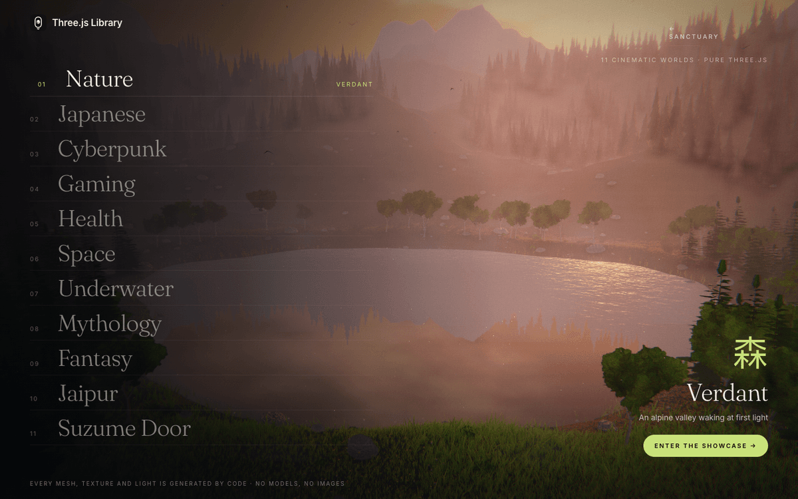
  </a>

</div>

<br />

---

## ✨ Highlights

- 🌿 **Zero 3D Asset Dependencies** — Every mesh, landscape, foliage clump, cloud volume, and texture is synthesized mathematically at runtime. No heavy `.gltf` or `.fbx` downloads.
- 📜 **Scroll-Driven Camera Rails** — Smooth mathematical camera progression tied to user scroll, enhanced with physics-based mouse parallax and adaptive damping.
- 🌅 **HDR Post-Processing Pipeline** — 6-pass bloom pyramid, radial volumetric light shafts (*god rays*), ACES filmic tone mapping, screen-space ambient occlusion (SSAO), and chromatic aberration.
- 🌊 **Planar Mirror Water Reflections** — Real-time clipped reflection camera matrix with dynamic ripple distortion and adaptive frame-skipping.
- 🚪 **Camera Projection Handoff** — Mathematical alignment from 2D photographic perspective into real-time 3D depth without breaking immersion (Suzume Doorway).
- ⚡ **Adaptive Quality Engine** — Continuous frame-time monitoring automatically scales internal render resolution to guarantee 60 FPS on any GPU.

---

## 🖼 Visual Showcase Gallery

<div align="center">
  <table>
    <tr>
      <td width="50%" align="center">
        <a href="https://threejs-scroll-showcases.vercel.app/showcase.html?s=nature">
          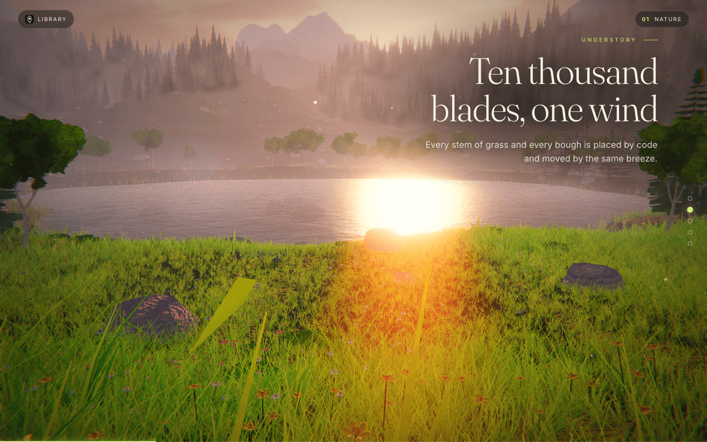<br />
          <b>01 · Nature (Verdant)</b>
        </a><br />
        <sub>Dawn over an alpine valley: spruce, birch, grass & mirror lake</sub>
      </td>
      <td width="50%" align="center">
        <a href="https://threejs-scroll-showcases.vercel.app/showcase.html?s=japanese">
          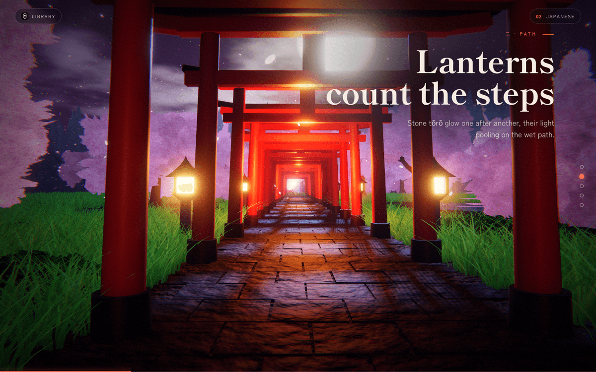<br />
          <b>02 · Japanese (Yoizakura)</b>
        </a><br />
        <sub>Vermilion torii corridor, stone lanterns, night sakura & pagoda</sub>
      </td>
    </tr>
    <tr>
      <td width="50%" align="center">
        <a href="https://threejs-scroll-showcases.vercel.app/showcase.html?s=cyberpunk">
          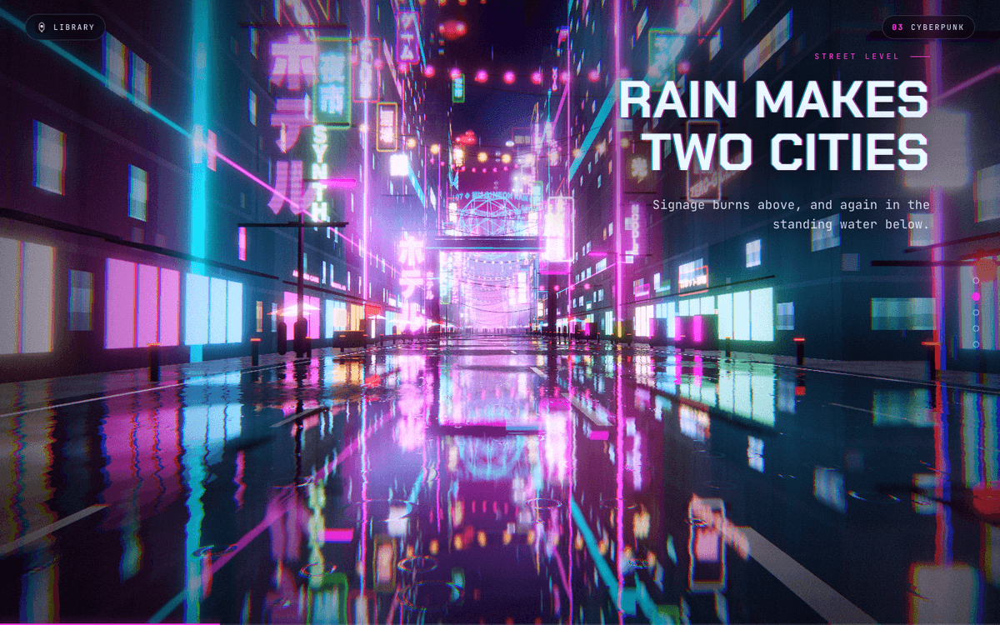<br />
          <b>03 · Cyberpunk (Neon Rain)</b>
        </a><br />
        <sub>Wet megacity street, neon reflections & streaming hover traffic</sub>
      </td>
      <td width="50%" align="center">
        <a href="https://threejs-scroll-showcases.vercel.app/showcase.html?s=space">
          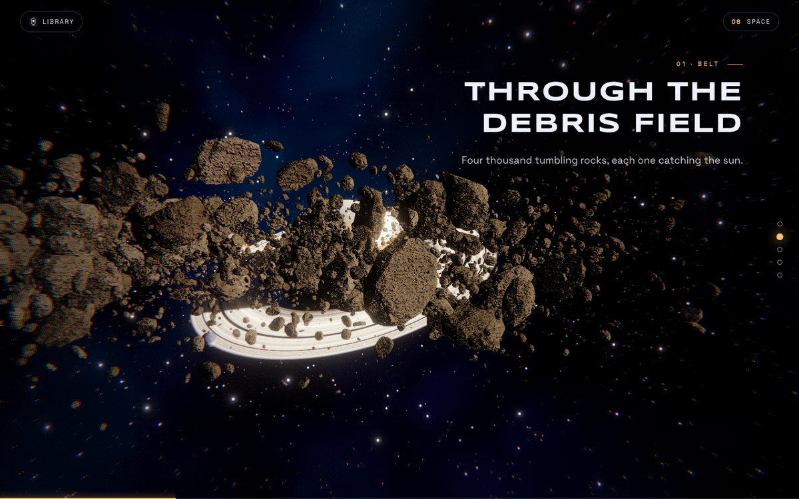<br />
          <b>06 · Space (Event Horizon)</b>
        </a><br />
        <sub>Living blue planet, asteroid belt, ringed giant & black hole</sub>
      </td>
    </tr>
    <tr>
      <td width="50%" align="center">
        <a href="https://threejs-scroll-showcases.vercel.app/showcase.html?s=gaming">
          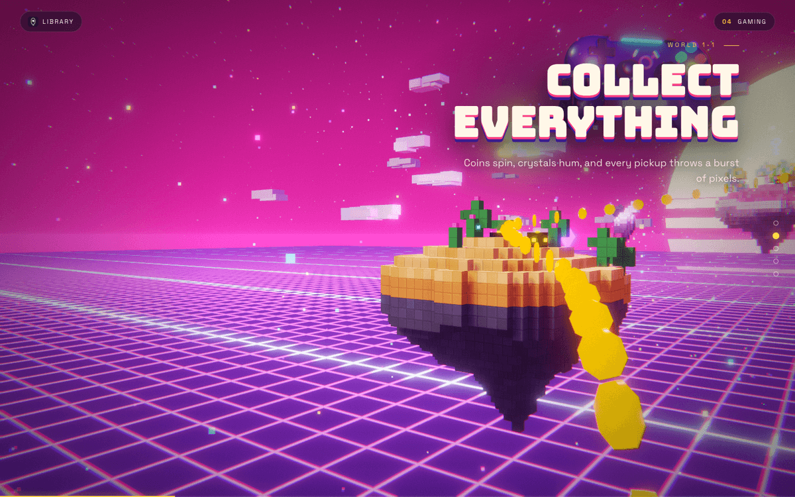<br />
          <b>04 · Gaming (Level Up)</b>
        </a><br />
        <sub>Floating voxel islands, synthwave grid & animated coin pickups</sub>
      </td>
      <td width="50%" align="center">
        <a href="https://threejs-scroll-showcases.vercel.app/showcase.html?s=jaipur">
          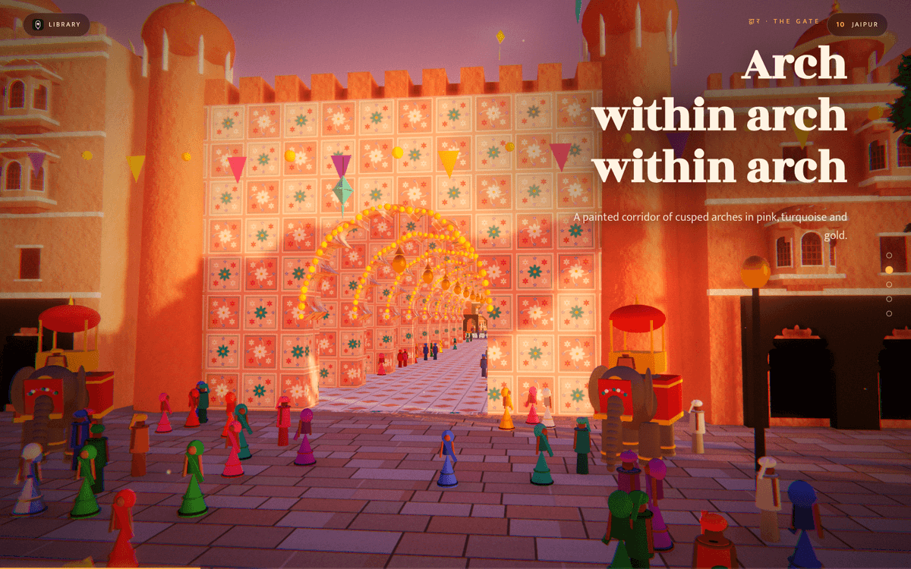<br />
          <b>10 · Jaipur (Gulabi Nagar)</b>
        </a><br />
        <sub>Hawa Mahal jharokhas, cusped arches & floating stepwell diyas</sub>
      </td>
    </tr>
    <tr>
      <td width="50%" align="center">
        <a href="https://threejs-scroll-showcases.vercel.app/showcase.html?s=underwater">
          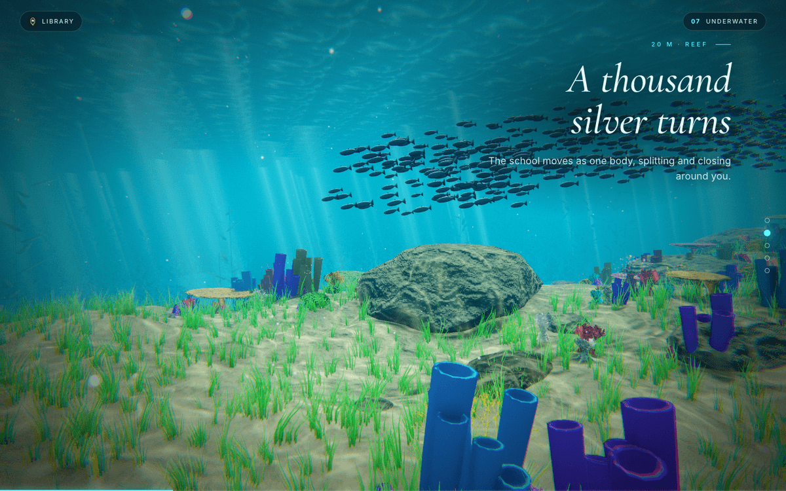<br />
          <b>07 · Underwater (Abyss)</b>
        </a><br />
        <sub>Coral caustics, swaying giant kelp forest & deep sea whale</sub>
      </td>
      <td width="50%" align="center">
        <a href="/">
          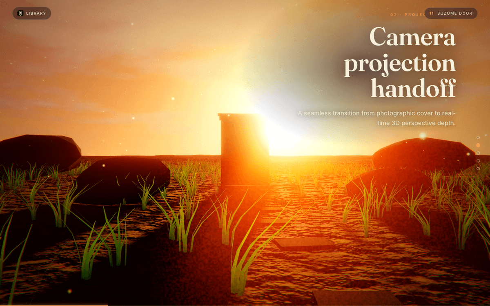<br />
          <b>11 · Suzume Door (Sunset Sanctuary)</b>
        </a><br />
        <sub>Weathered timber door in twilight meadow with glowing portal</sub>
      </td>
    </tr>
  </table>
</div>

---

## 🧭 Showcase Directory

| # | World | The Journey | Live 3D Demo | Source Code |
|:--:|:--|:--|:--:|:--:|
| **01** | **Nature** (*Verdant*) | Dawn over an alpine valley: spruce, birch, grass, mirror lake | [▶ **Open Live**](https://threejs-scroll-showcases.vercel.app/showcase.html?s=nature) | [`nature.js`](public/showcases/scenes/nature.js) |
| **02** | **Japanese** (*Yoizakura*) | Vermilion torii, stone lanterns, night sakura, five-storey pagoda | [▶ **Open Live**](https://threejs-scroll-showcases.vercel.app/showcase.html?s=japanese) | [`japanese.js`](public/showcases/scenes/japanese.js) |
| **03** | **Cyberpunk** (*Neon Rain*) | Wet megacity street with reflections, neon signage, hover traffic | [▶ **Open Live**](https://threejs-scroll-showcases.vercel.app/showcase.html?s=cyberpunk) | [`cyberpunk.js`](public/showcases/scenes/cyberpunk.js) |
| **04** | **Gaming** (*Level Up*) | Voxel islands over a synthwave grid, coin trail, pixel sprites | [▶ **Open Live**](https://threejs-scroll-showcases.vercel.app/showcase.html?s=gaming) | [`gaming.js`](public/showcases/scenes/gaming.js) |
| **05** | **Health** (*Vital*) | DNA, living cell, bloodstream, firing neurons, beating heart | [▶ **Open Live**](https://threejs-scroll-showcases.vercel.app/showcase.html?s=health) | [`health.js`](public/showcases/scenes/health.js) |
| **06** | **Space** (*Event Horizon*) | Living planet, asteroid belt, ringed giant, nebula, black hole | [▶ **Open Live**](https://threejs-scroll-showcases.vercel.app/showcase.html?s=space) | [`space.js`](public/showcases/scenes/space.js) |
| **07** | **Underwater** (*Abyss*) | Coral reef caustics, kelp forest, swimming whale, bioluminescence | [▶ **Open Live**](https://threejs-scroll-showcases.vercel.app/showcase.html?s=underwater) | [`underwater.js`](public/showcases/scenes/underwater.js) |
| **08** | **Mythology** (*Olympus*) | Marble temple above cloud sea, thunderstorm, eternal flame | [▶ **Open Live**](https://threejs-scroll-showcases.vercel.app/showcase.html?s=mythology) | [`mythology.js`](public/showcases/scenes/mythology.js) |
| **09** | **Fantasy** (*Arcanum*) | Floating isles under aurora, elder tree of light, crystal spire | [▶ **Open Live**](https://threejs-scroll-showcases.vercel.app/showcase.html?s=fantasy) | [`fantasy.js`](public/showcases/scenes/fantasy.js) |
| **10** | **Jaipur** (*Gulabi Nagar*) | Hawa Mahal, decorated elephants, cusped arches, stepwell diyas | [▶ **Open Live**](https://threejs-scroll-showcases.vercel.app/showcase.html?s=jaipur) | [`jaipur.js`](public/showcases/scenes/jaipur.js) |
| **11** | **Suzume Door** (*Sunset Sanctuary*) | Weathered timber door in twilight meadow, perspective projection handoff, 55,000 instanced grass blades, interactive keepsakes & portal | [▶ **Open Sanctuary**](/) | [`src/scene/`](src/scene/) · [`suzume.js`](public/showcases/scenes/suzume.js) |

> **Gallery Overview**: [threejs-scroll-showcases.vercel.app](https://threejs-scroll-showcases.vercel.app/) &nbsp;·&nbsp; Local gallery: [`/showcases/`](/showcases/) &nbsp;·&nbsp; Source folder: [`public/showcases/`](public/showcases/)

---

## 🚪 Flagship Experience: Suzume Doorway

<div align="center">
  <table>
    <tr>
      <td width="50%" align="center">
        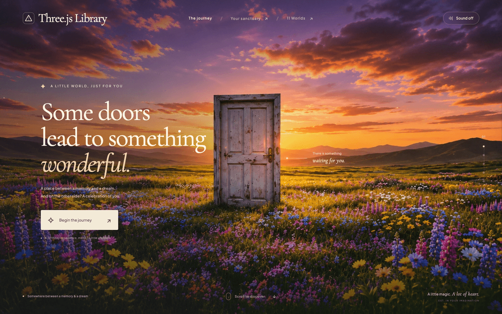<br />
        <b>Step 1: The Closed Doorway</b><br />
        <sub>Perspective projection aligned with photographic artwork</sub>
      </td>
      <td width="50%" align="center">
        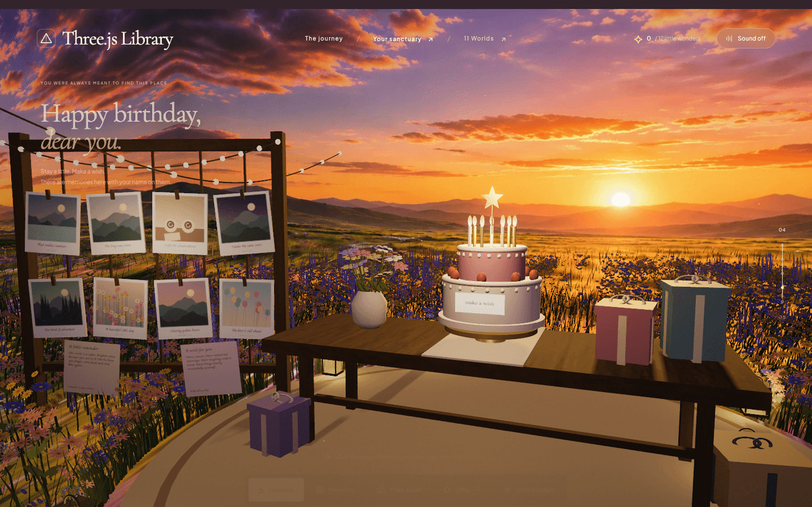<br />
        <b>Step 2: The Interactive Sanctuary</b><br />
        <sub>55,000 instanced grass blades, blowing candles & keepsakes</sub>
      </td>
    </tr>
  </table>
</div>

The root project (`/`) delivers an interactive 3D sunset doorway experience inspired by Makoto Shinkai's *Suzume*:

- **Seamless Camera Handoff**: Starts with a photographic closed-door framing. Upon scrolling, smoothly transitions into perspective-projected 3D geometry without popping or distortion.
- **55,000 Instanced Grass Blades**: Procedural wind oscillation shader moving 55,000 blades of grass, clovers, and 4 wildflower species.
- **Stencil Aperture Portal**: The celebratory sanctuary is revealed strictly through the doorway aperture until the camera crosses the threshold.
- **12 Interactive Wonders**:
  - Pinned notes and flippable Polaroids.
  - Interactive birthday cake with candles that extinguish via microphone breath detection or click.
  - 4 opening gift boxes with handwritten notes, photos, and melodies.
  - Synthesized ambient meadow chimes and wind generated locally via the Web Audio API.

---

## 🚀 Quick Start

### Prerequisites
- Node.js 18+
- npm or pnpm

### Installation

```sh
# Clone repository
git clone https://github.com/JayDev-27/threejs-library.git
cd threejs-library

# Install dependencies
npm install

# Start local development server
npm run dev
```

Visit `http://localhost:5173` to explore the **Suzume Doorway Sanctuary**, or `http://localhost:5173/showcases/` to browse all **11 cinematic procedural worlds**.

### Build for Production

```sh
# Compile static bundle to dist/
npm run build

# Preview production build locally
npm run preview
```

---

## 🧪 Verification & Automated Testing

The repository includes a comprehensive Playwright automation suite running in headless Chrome with full WebGL hardware acceleration:

```sh
# Run end-to-end verification (interactions, discoveries, shader errors)
npm run check

# Verify raycasting, microphone cleanup, and WebGL lifecycle
npm run check:lifecycle

# Verify 7-stage camera projection continuity and mobile framing
npm run check:cover
```

---

## 📁 Repository Structure

```text
threejs-library/
├── assets/
│   ├── threejs-logo.svg              # Three.js wireframe badge
│   └── screenshots/                  # High-resolution showcase screenshots
├── public/
│   ├── showcases/                    # 11 procedural scroll worlds
│   │   ├── index.html                # Interactive world selector
│   │   ├── showcase.html             # Cinematic scroll story engine
│   │   ├── lib/
│   │   │   ├── engine.js             # Post-processing, camera rails, planar mirror
│   │   │   ├── kit.js                # Procedural noise, geometry builder, sky
│   │   │   └── flora.js              # Grown trees, grass clumps, boulders
│   │   └── scenes/                   # 11 procedural scene modules
│   │       ├── nature.js, japanese.js, cyberpunk.js, space.js...
│   │       └── suzume.js             # Standalone timber doorway in meadow
│   ├── fonts/                        # Self-hosted typography
│   └── images/                       # Optimized WebP textures & clean plates
├── src/                              # Flagship Suzume Doorway app
│   ├── main.js                       # Journey, accessible controls, keepsake dialogs
│   ├── data/birthdayConfig.js        # Personal content & keepsakes
│   └── scene/                        # World, grass instancing, portal, atmosphere
└── scripts/                          # Playwright verification suites
```

---

## 📄 License & Credits

- **Code**: [MIT License](LICENSE) © 2026 [Jatin Pandey](https://github.com/JayDev-27).
- **Procedural Showcases**: Integrated and adapted from [Threejs Scroll Showcases](https://threejs-scroll-showcases.vercel.app/).
- **Engine & Core**: Built with [Three.js](https://threejs.org/) (r181), [GSAP ScrollTrigger](https://gsap.com/), and [Lenis](https://lenis.darkroom.engineering/).

<div align="center">
  <p><b>Crafted with pure mathematics, shaders, and Three.js.</b></p>
  <a href="#threejs-library--showcases">Back to top ↑</a>
</div>
